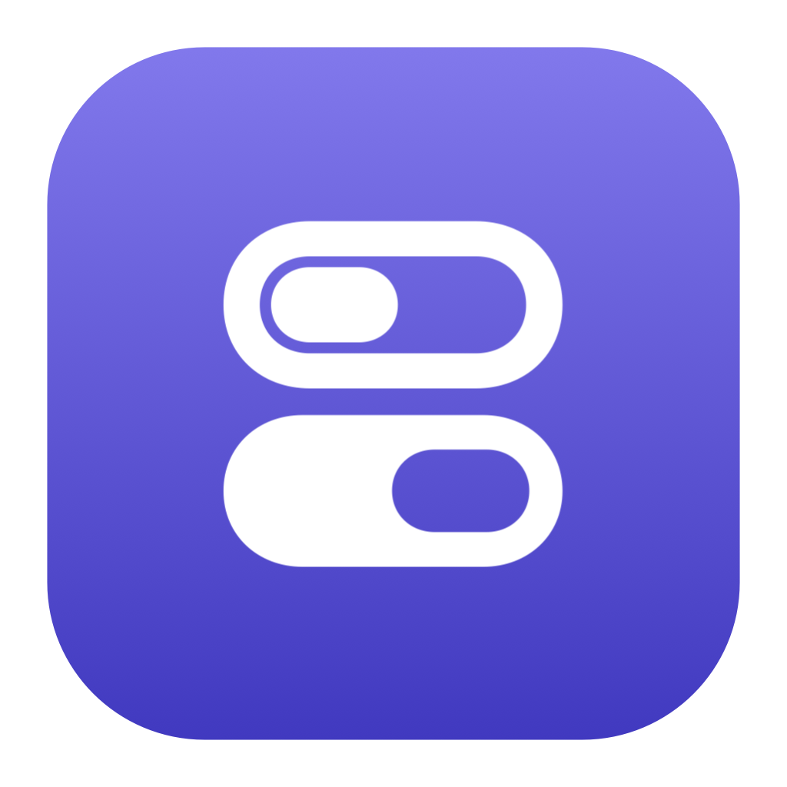
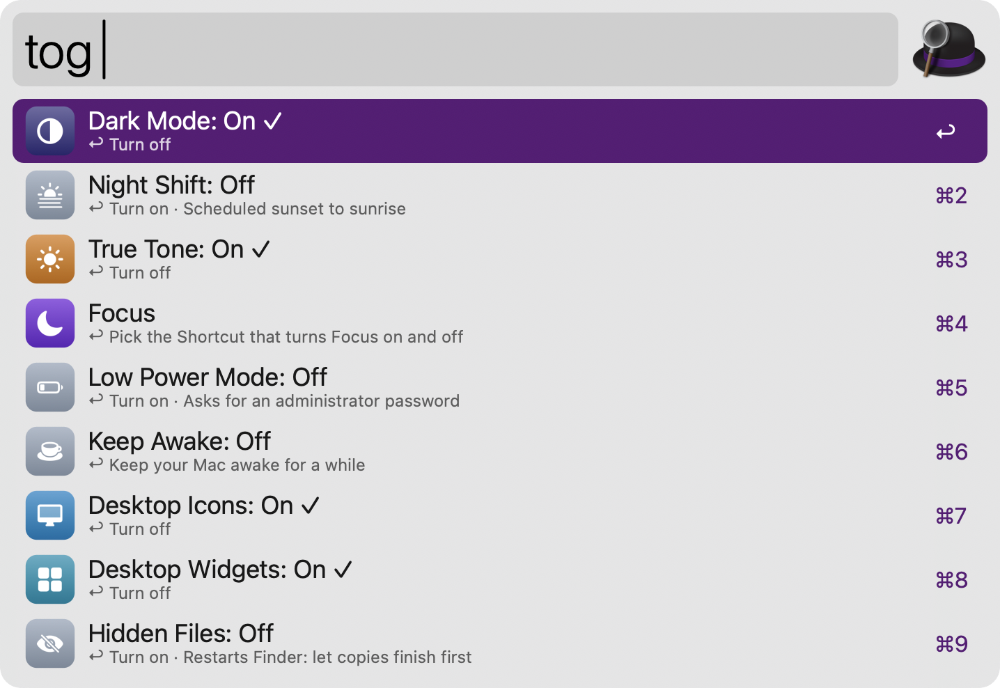
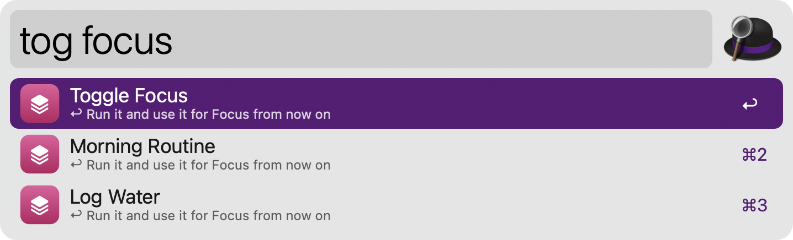
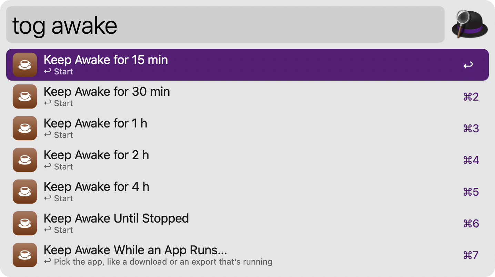
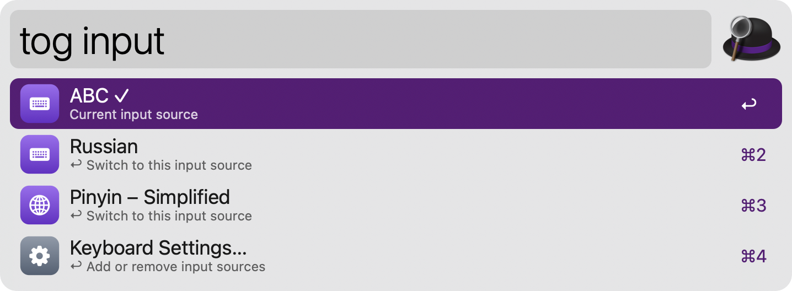
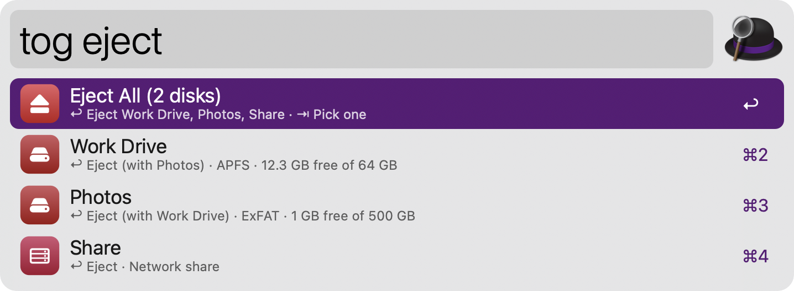

#  System Toggles

Flip the macOS settings you reach for every day from Alfred, each one showing whether it’s on right now: Dark Mode, Night Shift, True Tone, Focus, Low Power Mode, Keep Awake, desktop icons and widgets, hidden files, the Dock and menu bar, input sources, and ejecting disks. No dependencies: everything runs on tools that ship with macOS.

## Setup

Dark Mode, the Dock and the menu bar are changed through System Events, so the first time macOS asks to let Alfred control System Events. If you declined, turn it on in System Settings › Privacy & Security › Automation.

## Usage

See every toggle with its current state via the `tog` keyword. A toggle that’s on is marked ✓. Type part of a name, a synonym or initials to filter, like `tog dark`, `tog caffeine` or `tog dm`.



* <kbd>↩</kbd> Turn the setting on or off, or run the action.
* <kbd>⌘</kbd><kbd>↩</kbd> Turn it on or off and keep the list open, to change several in a row.
* <kbd>⇥</kbd> Open the choices of rows that have them (Focus, Keep Awake, Input Source, Eject).

Desktop icons and hidden files are Finder settings that Finder only reads when it starts, so changing them restarts Finder. It reopens its windows, but let file copies finish first. On macOS 14 and 15, hiding desktop icons uses “Show Items on Desktop” (or “In Stage Manager” while Stage Manager is on) and doesn’t restart Finder.

Changing Low Power Mode asks for an administrator password in macOS’s own dialog, which says what will change.

### Focus

macOS has no way for other apps to change Focus, so it runs a Shortcut of yours. Create one in Shortcuts with the “Set Focus” action set to Toggle, then pick it via `tog focus`. It’s remembered from then on, or set it in the Workflow’s Configuration. The ✓ state of Focus shows only when Alfred has Full Disk Access.



### Keep Awake

Keep your Mac awake for 15 minutes to 4 hours or until you stop it via `tog awake`, or type any duration, like `tog awake 45`, `tog awake 1h30` or `tog awake 2h`. Type a time to stay awake until then, like `tog awake until 17:30` or `tog awake 5pm`, or pick an app via `tog awake while` to stay awake until it quits. While it’s on, the row shows the time left and <kbd>↩</kbd> stops it. Whether the display stays on too is set in the Workflow’s Configuration.



### Input Sources

Switch to the next keyboard layout or input method with <kbd>↩</kbd> on the Input Source row, or list them all via `tog input` and type part of a name, like `tog input russ`.



### Eject

Eject all external disks, disk images and network shares at once, or pick one via `tog eject`. A disk with several volumes is ejected as a whole. When an app is using a disk, the notification names the app.



* <kbd>↩</kbd> Eject the disk.
* <kbd>⌥</kbd><kbd>↩</kbd> Force eject, even when an app is using it. Unsaved changes on the disk may be lost.
* <kbd>⌃</kbd><kbd>↩</kbd> Unmount only this volume and keep the rest of the disk.
* <kbd>⌘</kbd><kbd>↩</kbd> Reveal in Finder.
* <kbd>⌘</kbd><kbd>Y</kbd> Quick Look the volume.

### Dock, Screen and Apps

Choose the Dock position via `tog position`. The list also starts the screen saver, locks the screen, puts the displays to sleep, and hides all apps or every app but the frontmost one.

Configure the Hotkeys to show the toggles, turn Dark Mode on or off, or turn Keep Awake on or off from anywhere. The keyword can be changed in the Workflow’s Configuration.

## Development

```bash
swift tools/make_icons.swift tools/icons.json src   # regenerate icons
python3 tools/build.py --package                     # write src/info.plist and dist/*.alfredworkflow
python3 tests/test_system_toggles.py                 # run the tests (never changes real settings)
```

Actions honour `ST_DRY_RUN=1`, which prints what they would do instead of doing it, and `ST_FIXTURE=file.json`, which also replaces every state reader with the file’s contents:

```bash
cd src && ST_DRY_RUN=1 osascript -l JavaScript toggles.js act '{"op":"toggle","id":"dark","value":false}'
```

## AI disclosure

This workflow was developed with the help of Claude (Anthropic), an AI assistant. The code is reviewed and tested by the author.
